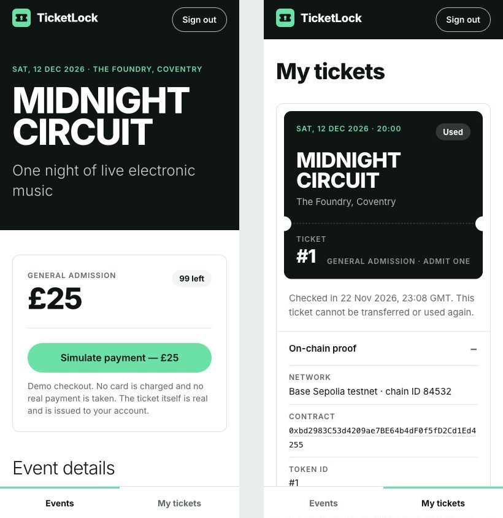
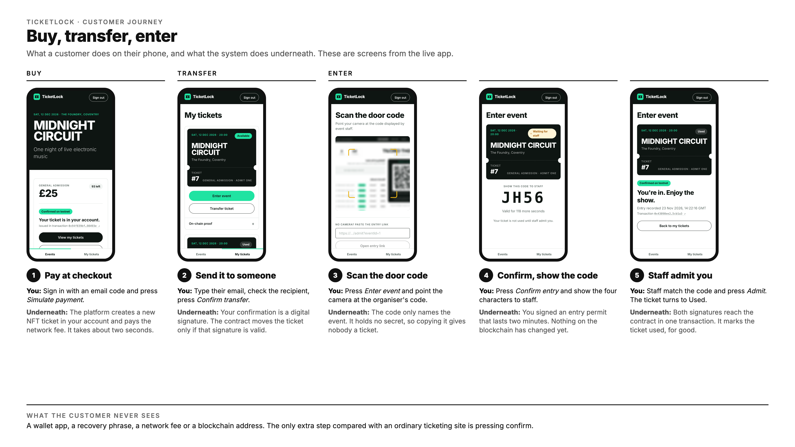
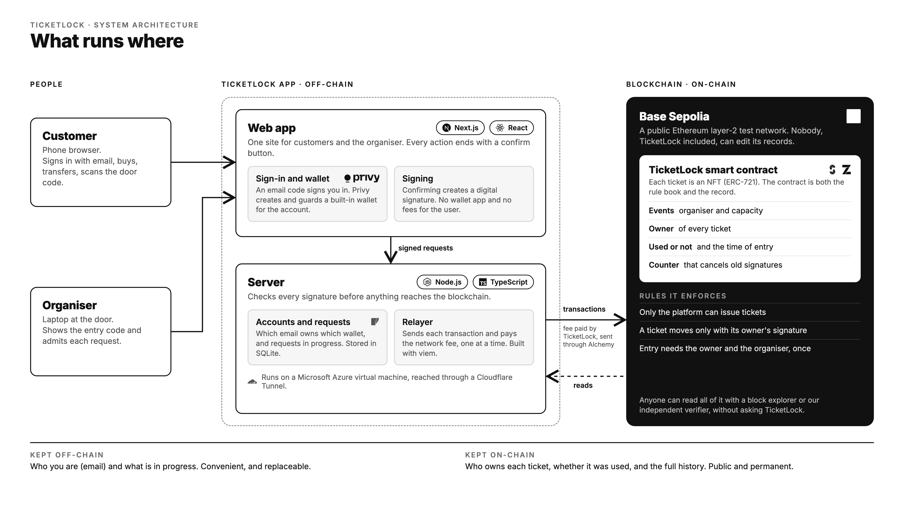
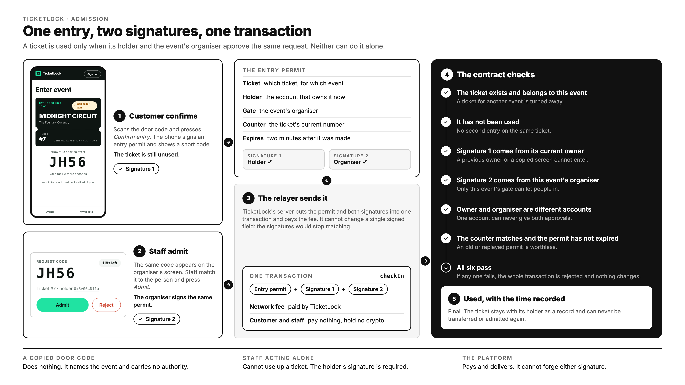
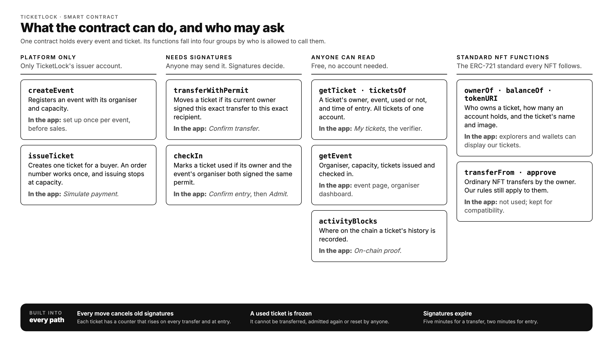

# Tickets you own, transfer and use once

TicketLock is a ticketing demo in which every ticket is recorded on a public blockchain. Anyone
can check who owns a ticket and whether it has been used, and nobody, including us, can quietly
change that record. For the customer it works like an ordinary ticketing site: sign in with
email, buy, send a ticket to a friend, scan a code at the door.

This repository holds the working demo built for a university blockchain venture project: the
smart contract, the web app, the brand assets and the documentation.

| | |
| --- | --- |
| Live demo | https://ticketlock.kylewu.me |
| Check any ticket | https://ticketlock.kylewu.me/verify |
| Smart contract | [`0xbd2983C5…4255` on Base Sepolia](https://sepolia.basescan.org/address/0xbd2983C53d4209ae7BE64b4dF0f5fD2Cd1Ed4255#code), source verified |

The demo runs on a test network. The checkout is simulated and no real money is involved.

## New to blockchain? Start here

[**How TicketLock works, without the jargon**](docs/how-it-works.md) explains the six ideas the
system relies on, each with an everyday comparison. The [glossary](docs/glossary.md) covers every
term used in this repository.

## What a customer does

Three things can happen to a ticket. Someone **buys** it and it is issued to their account.
Someone **transfers** it to another account by email. Someone **enters** with it, and it is marked
used. The customer never installs a wallet, never sees a blockchain address unless they ask, and
never pays a network fee. Details are in [user flows](docs/user-flows.md).

## How it works

- **The web app** is what people use. Signing in creates a wallet for the account behind the
  scenes, provided by Privy. Pressing a confirm button makes that wallet sign the request.
- **The server** checks each signature, keeps the private data (which email has which wallet,
  requests in progress), and runs the relayer, which delivers each request to the blockchain and
  pays the fee.
- **The smart contract** on Base Sepolia holds the facts that need to be trusted: the events,
  who owns each ticket, whether it was used, and the rules for changing any of that.

## Entering an event takes two signatures

A ticket is used only when its holder and the event's organiser approve the same request. The
customer scans the door code and confirms; staff see a matching short code and admit; both
signatures reach the contract in a single transaction. A copied door code does nothing, staff
cannot use up a ticket without its holder, and the platform cannot forge either signature.

## The smart contract

One contract, about 380 lines, built on OpenZeppelin's audited components and covered by 24
automated tests. [The smart contract guide](docs/smart-contract.md) explains every function in
plain language, where the app uses it, and how the rules stop misuse.

## Built with

| Part | Technology |
| --- | --- |
| Blockchain | Base Sepolia, an Ethereum layer-2 test network |
| Smart contract | Solidity, OpenZeppelin Contracts (ERC-721), Hardhat |
| Sign-in and wallets | Privy: email codes and embedded wallets |
| Web app | Next.js, React, TypeScript, Tailwind CSS |
| Blockchain access | viem, Alchemy |
| Server data | SQLite |
| Hosting | Microsoft Azure VM behind a Cloudflare Tunnel |

The reasons for each choice are in [design decisions](docs/design-decisions.md).

## What the demo shows, and what it does not

It shows ownership that moves only with the owner's signature, ordinary email accounts, fees paid
by the platform, ticket status that anyone can verify, and tickets that can be used exactly once.

It does not include a resale marketplace, price caps, real payments or refunds, and it does not
prove that a person is physically at the door. The platform still issues the tickets, Privy still
safeguards the wallets, and the organiser still decides whom to admit.

## Documentation

| Read this | For |
| --- | --- |
| [How it works](docs/how-it-works.md) | The whole system in plain language |
| [User flows](docs/user-flows.md) | Buying, transferring and entering, step by step |
| [The smart contract](docs/smart-contract.md) | Every function, the rules, tests and fees |
| [Design decisions](docs/design-decisions.md) | Why a public chain, which assets, what is still centralised |
| [Pitch kit](docs/pitch-kit.md) | Slide-ready points, figures, images and likely questions |
| [Glossary](docs/glossary.md) | Every term, briefly |
| [Brand](docs/brand.md) | Logo files, colours and type |
| [Diagrams](docs/diagrams) | The six diagrams as PNG and SVG, with their sources |
| [Maintainer guide](docs/maintainers) | Running, deploying and recording the demo |

## Repository layout

| Path | Contents |
| --- | --- |
| `contracts/` | The smart contract, its tests and the deploy scripts |
| `web/` | The web app, its server and the relayer |
| `brand/` | Logo and brand assets |
| `docs/` | Documentation and diagrams |
| `deployments/` | The record of the published contract |
| `deploy/`, `recording/` | Hosting scripts and the demo-video tooling |

## Credits

Built by the TicketLock team as a university course project. The contract, web app, diagrams and
documentation were produced with substantial help from AI coding tools, directed and reviewed by
the team.

Technology logos in the diagrams identify the tools used and belong to their owners; see the
[diagrams README](docs/diagrams/README.md#third-party-marks). Released under the [MIT licence](LICENSE).
