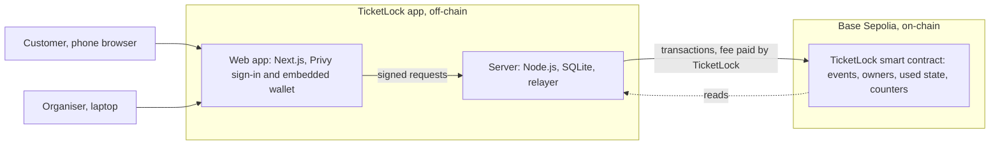
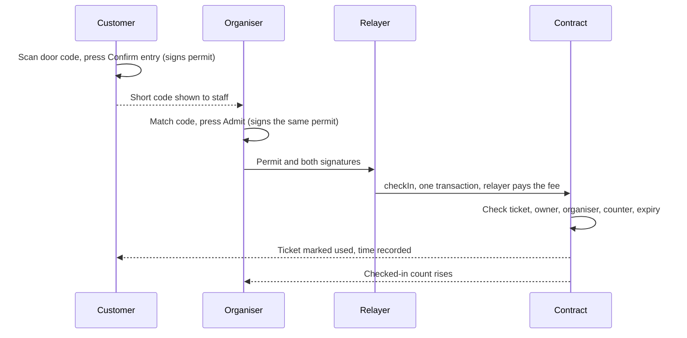
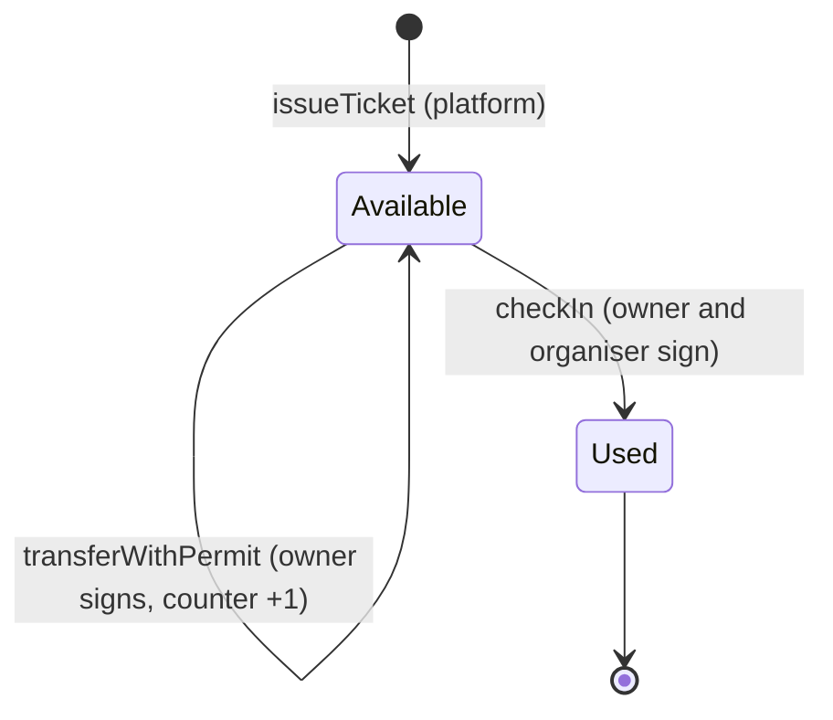
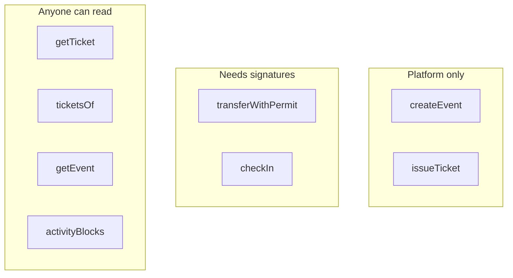

# Diagrams

Six 16:9 diagrams, each as a 3840×2160 PNG and an SVG.

| Diagram | Shows |
| --- | --- |
| `architecture` | What runs where, and the technology in each layer |
| `user-journey` | Buy, transfer and enter, with real screens |
| `admission` | The two-signature entry |
| `contract-map` | The contract's functions, grouped by who may call them |
| `ticket-lifecycle` | A ticket's states, with a real example |
| `data-split` | What is stored on-chain and off-chain |

## Editing

Each diagram is a small HTML file in `src/` sharing `src/style.css`. To rebuild:

```sh
pnpm install
node docs/diagrams/build.mjs            # all of them
node docs/diagrams/build.mjs admission  # just one
```

This needs Google Chrome (set `CHROME` if it is not in the default macOS location) and
`pdftocairo` from Poppler for the SVG step. The screens in `src/shots/` come from
`recording/record.mjs` run with `TICKETLOCK_SHOTS=1`.

Placeholders in the HTML: `{{icon:slug:size:colour}}` inserts a Simple Icons glyph,
`{{logo:privy|base|ticketlock:height:colour}}` inserts a mark from `src/logos/`, and
`{{shot:name}}` points at a screenshot.

## Text versions

The same structures in Mermaid, for quick edits and for places that render Mermaid directly.









## Third-party marks

Technology logos are shown only to identify the tools used. Most come from
[Simple Icons](https://simpleicons.org) (CC0). The Privy and Base marks come from those projects'
own brand pages. All trademarks belong to their owners; TicketLock is not affiliated with or
endorsed by any of them.
