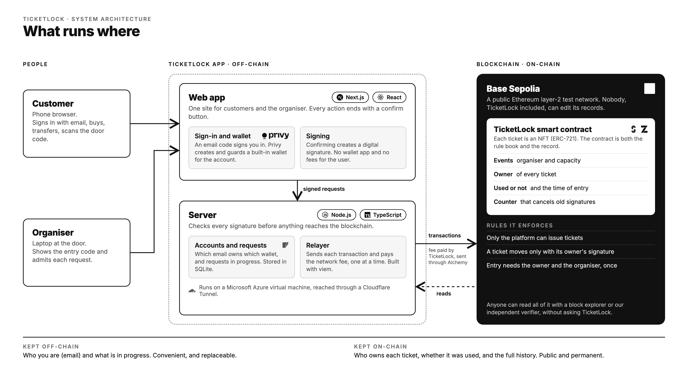
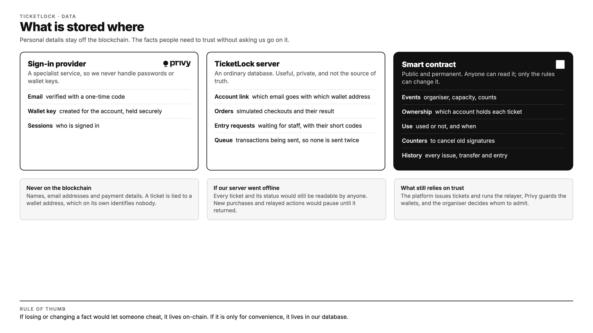

# How TicketLock works, without the jargon

This page is for readers with no blockchain background. It explains the handful of ideas the
system relies on, then follows a ticket from purchase to the door. Every technical word is
introduced with an everyday comparison first; the [glossary](glossary.md) lists them all.

## The problem in one paragraph

With an ordinary e-ticket, the ticketing company's private database is the only record of who
holds a ticket and whether it has been used. A buyer of a second-hand ticket cannot check that
the ticket is real, that it has not been sold twice, or that it has not already been scanned.
They have to trust the seller or the platform. TicketLock puts those three facts (who owns it,
is it genuine, has it been used) on a public record that anyone can check and nobody can quietly
edit, while keeping the experience as simple as a normal ticketing site.

## Six ideas, each with a comparison

**1. A blockchain is a shared notebook.** Picture a notebook that thousands of independent
computers each keep a copy of. A new line is added only when they agree on it, and old lines can
never be erased or changed. Nobody owns the notebook, including us. TicketLock uses a public
blockchain called Base, in its free test version, Base Sepolia.

**2. A smart contract is a vending machine for rules.** It is a small program stored in that
notebook. Like a vending machine, it does exactly what its rules say and cannot be talked into
an exception. Our contract holds the rules for tickets: who may create one, what is needed to
move one, and what is needed to use one. Once published, we cannot change those rules either.

**3. An NFT is a numbered entry in the notebook.** "NFT" just means a unique item with one
recorded owner. Each TicketLock ticket is one: ticket number 6 belongs to exactly one account,
and the contract knows which.

**4. A wallet is a signature stamp.** A wallet is not a place where things are stored. It is a
secret key that lets its owner stamp a message so that anyone can verify the stamp is genuine
and the message was not altered. Each TicketLock account gets one automatically at sign-up. The
user never sees it; a company called Privy creates it and keeps it safe.

**5. A signature is consent; a transaction is the act.** When a user presses *Confirm transfer*,
their wallet stamps a message such as "move ticket 6 to this account, valid for five minutes".
That signature changes nothing by itself. Something has to carry it to the contract, and that
delivery is called a transaction.

**6. Someone has to pay the postage.** Every transaction costs a small network fee, usually
called gas. Normally the user pays it in cryptocurrency, which is the main reason blockchain apps
feel difficult. In TicketLock a server we run, the relayer, delivers every transaction and pays
the fee. The relayer is only a courier: the contract checks the user's signature, so the courier
cannot change what was signed or act without it.

## What happens in each step

| The user does | Underneath |
| --- | --- |
| Signs in with an email code | Privy verifies the email and creates the account's wallet. |
| Presses *Simulate payment* | The relayer asks the contract to create a ticket owned by the buyer's account. No real money moves in this demo. |
| Enters a friend's email and confirms a transfer | The wallet signs the transfer. The relayer delivers it. The contract checks the signature and changes the owner. |
| Scans the door code and confirms entry | The wallet signs an entry permit. Nothing is recorded yet. |
| Staff press *Admit* | The organiser's wallet signs the same permit. The relayer delivers both signatures in one transaction and the contract marks the ticket used. |

Each of these takes two to four seconds on the test network. The step-by-step version with
screens is in [user-flows.md](user-flows.md).

## What lives where

Only what must be trustworthy goes on the blockchain: ownership, whether a ticket was used, and
the history. Emails, names and anything personal stay in ordinary private systems. A ticket is
linked to a wallet address, a long code that identifies nobody on its own.

## Why this is more than a database

- **Anyone can verify a ticket without asking us.** The [verifier page](https://ticketlock.kylewu.me/verify)
  reads the public record directly. A buyer, a venue or another ticketing company would see the
  same answer.
- **We cannot rewrite history.** Not the ownership, not the "used" mark, not the rules.
- **A ticket moves only with its owner's consent.** The platform delivers transactions but
  cannot move a ticket by itself.
- **A ticket can be used once.** The contract refuses a second entry and refuses to move a used
  ticket.

## What still depends on trust

It would be misleading to say nothing does. The platform decides when tickets are issued. Privy
looks after the wallets. Our server must be running for purchases and relayed actions. The
organiser decides whom to let through the door. [Design decisions](design-decisions.md) lists
these honestly, along with what a production version would change.
