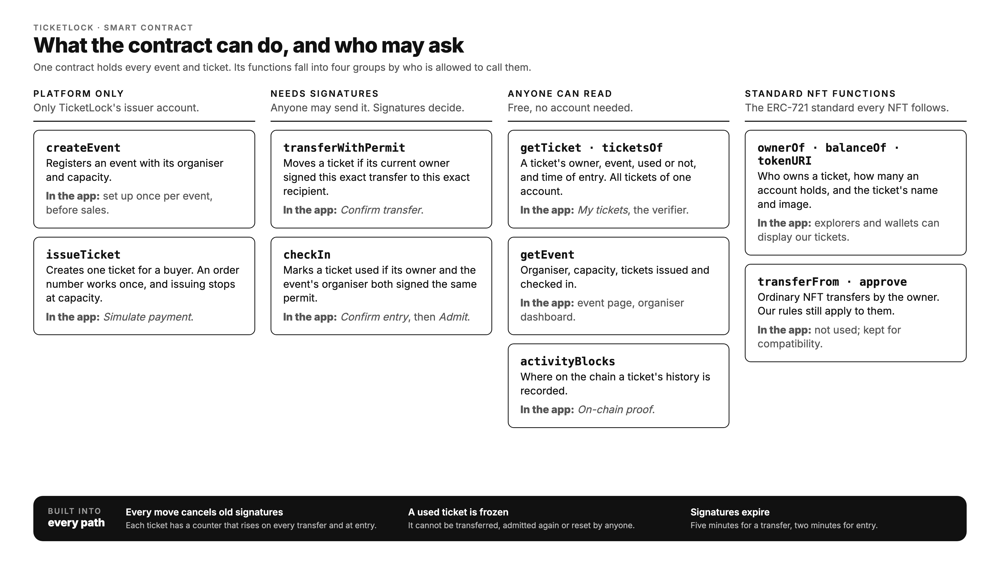

# The smart contract

Everything TicketLock records on the blockchain is in one contract, `TicketLockDemo`. This page
explains what it remembers, what each function does and where the app uses it. No programming
background is assumed; developers can read the source in
[`contracts/contracts/TicketLockDemo.sol`](../contracts/contracts/TicketLockDemo.sol).

| | |
| --- | --- |
| Network | Base Sepolia (chain ID 84532) |
| Address | [`0xbd2983C53d4209ae7BE64b4dF0f5fD2Cd1Ed4255`](https://sepolia.basescan.org/address/0xbd2983C53d4209ae7BE64b4dF0f5fD2Cd1Ed4255#code) |
| Source | Published and verified on Basescan, so anyone can read the exact code that is running |
| Built with | Solidity 0.8.28 and OpenZeppelin Contracts 5 (ERC-721, signature checking, reentrancy guard) |
| Size | About 380 lines, covered by 24 automated tests |

## What the contract remembers

| Record | Contents |
| --- | --- |
| Issuer | The one account allowed to create events and tickets. Fixed when the contract was published. |
| Events | For each event: its organiser, its capacity, how many tickets were issued and how many were checked in. |
| Tickets | For each ticket: its event, its number within the event, its owner, whether it was used, when, and its counter. |
| Orders | Which order numbers have already produced a ticket, so one order can never produce two. |
| Activity | Which blocks of the chain contain each ticket's history, so the history is quick to find. |

It stores no names, emails or payment details.

## Functions that change something

### `createEvent(organiser, capacity)`

- **Who can call it:** only the issuer.
- **What it does:** records a new event and returns its ID. The organiser and capacity cannot be changed later.
- **It refuses if:** the organiser is empty or the capacity is zero.
- **In the app:** run once from a setup script before the demo. There is no screen for it.

### `issueTicket(eventId, recipient, orderId)`

- **Who can call it:** only the issuer.
- **What it does:** creates one ticket for that event, owned by the recipient.
- **It refuses if:** the event does not exist, the event is sold out, or that order number was already used.
- **In the app:** *Simulate payment*. The server creates an order number and the relayer calls this.

### `transferWithPermit(permit, ownerSignature)`

- **Who can call it:** anyone who holds a valid signature. In practice, the relayer.
- **What it does:** moves the ticket from its owner to the recipient named in the permit, and raises the ticket's counter.
- **It checks that:** the ticket exists and belongs to the stated event; it is not used; the permit's "from" is the current owner; the recipient is a real, different account; the counter matches; the permit is inside its five-minute window; and the signature really comes from the owner.
- **In the app:** *Confirm transfer*.

### `checkIn(permit, ownerSignature, gateSignature)`

- **Who can call it:** anyone who holds both valid signatures. In practice, the relayer.
- **What it does:** marks the ticket used, records the time, raises the counter and adds one to the event's checked-in count. The ticket stays with its owner.
- **It checks that:** everything `transferWithPermit` checks about the ticket and owner; the "gate" in the permit is this event's organiser; the owner and the organiser are different accounts; the permit is inside its two-minute window; and both signatures are over exactly the same permit.
- **In the app:** the customer's *Confirm entry* produces the first signature and the organiser's *Admit* produces the second.

## Functions that only read

These are free and open to everyone, with no account.

| Function | Answers | Used by |
| --- | --- | --- |
| `getTicket(tokenId)` | Owner, event, ticket number, used or not, time of entry, counter | Ticket cards, the verifier |
| `ticketsOf(owner)` | Every ticket an account holds, with the same details | *My tickets* |
| `getEvent(eventId)` | Organiser, capacity, issued and checked-in counts | Event page, organiser dashboard |
| `activityBlocks(tokenId)` | Where the ticket's history is recorded | *On-chain proof*, the verifier |
| `orderToken(orderId)` | Which ticket an order produced, if any | Reconciliation after a restart |
| `ownerOf`, `balanceOf`, `tokenURI` | Standard NFT questions: owner, count, name and image | Explorers and wallets |

The ticket's image is drawn by the contract itself, so it does not depend on any website staying online.

## Standard NFT transfers

Because the ticket is a standard NFT, the usual `transferFrom` and `approve` functions exist. The
app does not use them, since they would require the user to pay gas. They are subject to the same
rules: any transfer raises the counter, and a used ticket cannot be moved by any route.

## Events the contract announces

Each change emits a public log entry that explorers and our history view read:
`EventCreated`, `TicketIssued`, `Transfer` (the standard NFT one) and `TicketCheckedIn`.

## How the rules stop misuse

| Someone tries to… | What stops it |
| --- | --- |
| Reuse an old transfer signature | The counter went up when the ticket moved, so the signature no longer matches. This holds even if the ticket comes back to the same person. |
| Change the recipient of a signed transfer | The signature covers the recipient. Any change makes it invalid. |
| Use a signature on another network or contract | The signature includes the network ID and this contract's address. |
| Enter with only the holder's approval | The organiser's signature is also required. |
| Use up a ticket without its holder | The holder's signature is also required. |
| Act as gatekeeper for someone else's event | The gate must be the organiser recorded for that event. |
| Have an organiser admit their own ticket alone | Holder and organiser must be different accounts. |
| Enter twice, or sell a ticket after using it | A used ticket is refused for entry and for every kind of transfer. |
| Hold a signature and use it much later | Permits expire: five minutes for transfers, two minutes for entry. |
| Issue more tickets than the venue holds | Issuing stops at the event's capacity. |
| Get two tickets from one order | An order number works once. |
| Run two conflicting requests at once | Whichever the network processes first wins; the other fails its checks. |

## How it was tested

The 24 automated tests cover issuing (wrong caller, repeated order, capacity), signed transfers
(tampered recipient, wrong signer, wrong network, expiry, replay), admission (one signature only,
wrong organiser, altered permit, double use) and the interactions between them. A second review pass, by a separate AI model,
found no high or medium severity issues; the one behavioural finding, an
organiser admitting their own ticket with a single signature, was fixed before deployment.

## What it costs to run

Measured on Base Sepolia from real transactions. Test-network fees are not a forecast of
main-network fees, which move with demand, but they show the relative size of each action.

| Action | Gas used | Fee paid by the relayer |
| --- | --- | --- |
| Publish the contract (once) | 3,025,681 | 0.0000182 ETH |
| Issue a ticket | 257,658 | 0.0000015 ETH |
| Transfer a ticket | 101,408 | 0.0000006 ETH |
| Check in a ticket | 67,565 | 0.0000004 ETH |
