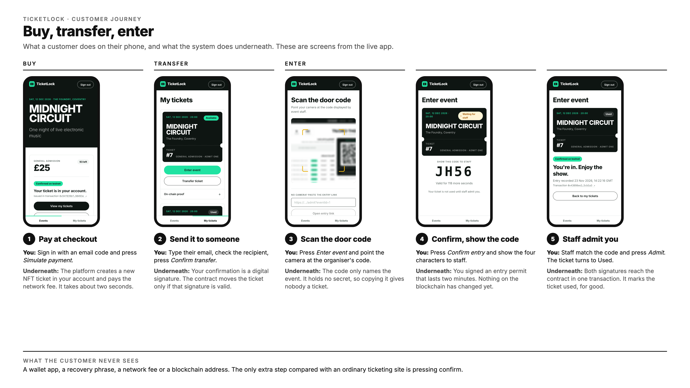
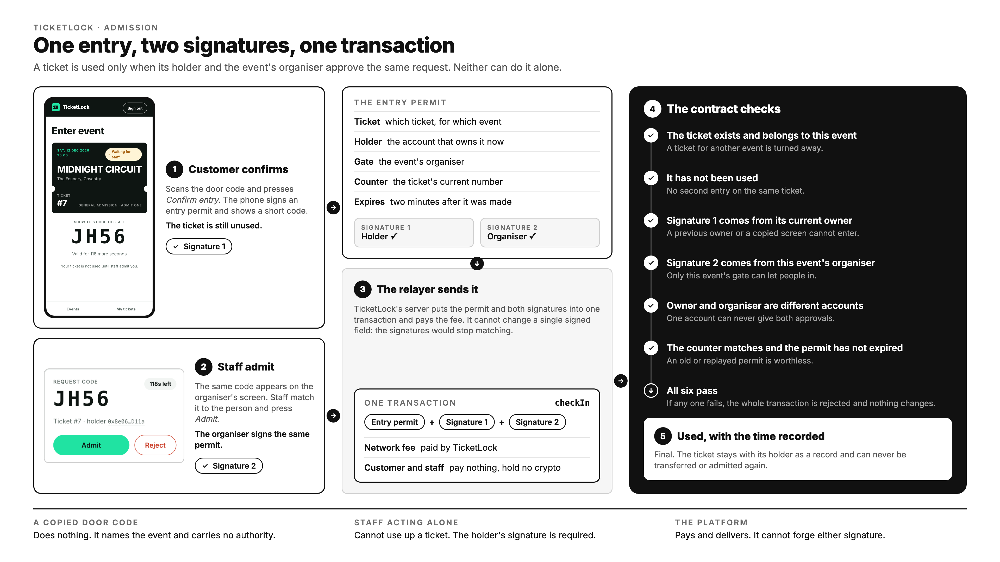

# User flows

Three things can happen to a ticket: someone buys it, someone transfers it, someone uses it to
enter. This page walks through each from the user's side and shows what the system does at the
same moment. The screens are from the live app.

## Accounts

A user types their email, receives a six-digit code, and is signed in. Behind that one step,
Privy creates a wallet for the account. The same wallet comes back on every later sign-in, so
tickets stay with the account. There is no password, no browser extension and no recovery phrase
to write down.

The organiser signs in the same way. What makes them the organiser is that their account's
address was written into the contract when the event was created. No setting in the app can
grant that role.

## 1. Buy

1. The customer opens the event and presses **Simulate payment — £25**.
2. The server records the order and asks the contract to issue a ticket to the customer's account.
3. The page shows *Issuing your ticket* until the network confirms, then *Confirmed on testnet*.

The checkout is simulated: no card is charged. The ticket is real. Pressing the button twice, or
refreshing the page, continues the same order instead of creating a second ticket.

## 2. Transfer

1. On an available ticket the holder presses **Transfer ticket** and types the recipient's email.
2. The app shows who will receive it. The holder presses **Confirm transfer**.
3. The holder's wallet signs "move this ticket to that account". The relayer delivers it.
4. The contract checks the signature and changes the owner. The ticket leaves one account and
   appears in the other.

The recipient does nothing and pays nothing. They must already have a TicketLock account, so the
app knows which wallet to send to. The app calls this a transfer on purpose: the demo moves
ownership, and it does not handle a sale price or a payment between the two people.

## 3. Enter

1. The organiser's screen shows one QR code for the event.
2. The customer presses **Enter event**, scans it, and presses **Confirm entry**. Their wallet
   signs an entry permit that is valid for two minutes. The phone shows a four-character code and
   *Waiting for staff*. The ticket is still unused.
3. The same code appears on the organiser's dashboard. Staff check it against the phone in front
   of them and press **Admit**. The organiser's wallet signs the same permit.
4. The relayer sends both signatures to the contract in one transaction.
5. The contract checks everything and marks the ticket used, with the time. Both screens update.

### Why two signatures

| If only this were required | What could go wrong |
| --- | --- |
| The QR code | Anyone could photograph the code and "enter" from home. |
| The customer's signature | A customer could mark their own ticket used by accident, far from the venue, or a copied code could trigger it. |
| The organiser's signature | Staff could use up a ticket without its holder present. |

Requiring both, over the same permit, means a ticket is used only when its holder asks and the
venue agrees. The short code is a convenience for staff to pick the right request; the contract
does not depend on it.

### What if something goes wrong

- **Staff do not respond in two minutes.** The request expires and the ticket stays available.
  The customer confirms again.
- **Staff press Reject.** Same result: nothing is used.
- **The ticket was transferred while a request was waiting.** The request stops working, because
  every transfer raises the ticket's counter and the permit was signed for the old value.
- **Someone tries to enter with a used ticket.** The app says it has been used, and the contract
  would refuse it in any case.

## Checking a ticket independently

Every ticket card has an **On-chain proof** panel showing the network, the contract, the owner
and each step of the ticket's history with a link to the public transaction. The
[verifier](https://ticketlock.kylewu.me/verify) shows the same facts without signing in, read
straight from the blockchain rather than from our server.
